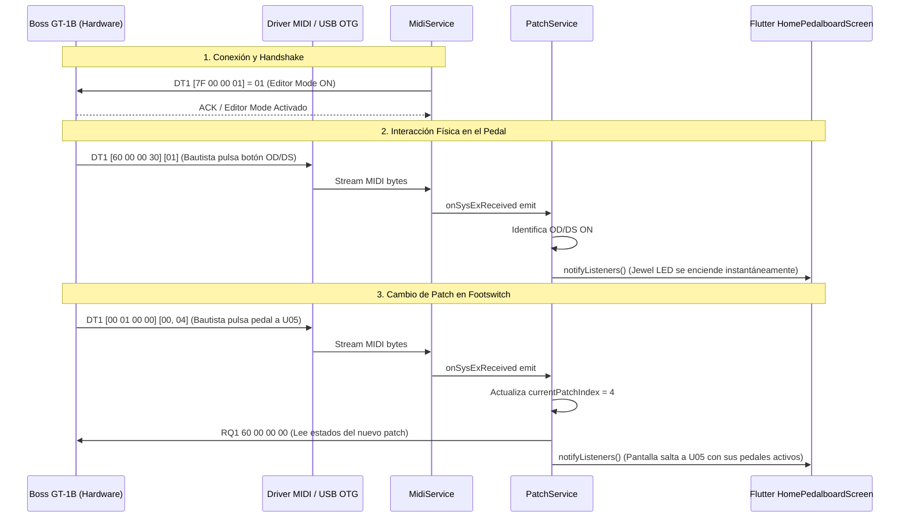

# Mapa Integral de Memoria y Protocolo de Interacción: Boss GT-1B

Este documento detalla la arquitectura completa de direcciones SysEx, comandos de control, bloques de efectos, parámetros y el modelo de sincronización bidireccional entre la aplicación **tone_gt_studio** y el procesador multiefectos para bajo **Boss GT-1B** (Roland Corporation).

---

## 1. Identificación y Handshake de Conexión

### 1.1 Identificadores de Hardware
* **Manufacturer ID (Roland):** `0x41`
* **Device ID por defecto:** `0x00` (o `0x10` según canal global)
* **Model ID Boss GT-1B:** `00 00 00 3E`
* **Model ID Boss GT-100 / Familia:** `00 00 60`
* **USB Vendor ID:** `0x0582` (1410 dec)
* **USB Product ID (GT-1B):** `0x01F3` (500 dec)

### 1.2 Activación de Modo Editor (Bidireccionalidad en Vivo)
Para que la pedalera **transmita sus cambios físicos a la app** (pulsaciones de botones negros, cambio de banco con footswitches, afinador, movimiento del pedal de expresión o giro de perillas), debe ponerse en **Modo Editor**:

* **Dirección:** `7F 00 00 01` (`editor_comunication_mode`)
* **Activar (al conectar):** `DT1 [7F 00 00 01] [01]`  
  Trama completa: `F0 41 00 00 00 00 3E 12 7F 00 00 01 01 7F F7`
* **Desactivar (al desconectar):** `DT1 [7F 00 00 01] [00]`  
  Trama completa: `F0 41 00 00 00 00 3E 12 7F 00 00 01 00 00 F7`

---

## 2. Mapa de Bloques y Conmutadores (Switches)

Cuando la pedalera está en Modo Editor y se pulsa cualquier botón o footswitch, emite automáticamente una trama `DT1` con la dirección del parámetro conmutado (`01` = ON, `00` = OFF):

| Bloque | Función | Dirección SysEx | Botón Físico / Control |
| :--- | :--- | :---: | :--- |
| **COMP** | Compresor / Limiter | `60 00 00 20` | Botón negro iluminado `COMP` |
| **OD/DS** | Overdrive / Distorsión | `60 00 00 30` | Botón negro iluminado `OD/DS` |
| **PREAMP** | Previo de Bajo / Amp A | `60 00 00 50` | Botón negro iluminado `PREAMP` |
| **EQ** | Ecualizador Paramétrico 4 bandas | `60 00 01 30` | Menú Memory Edit / EQ |
| **FX1** | Multi-efecto 1 (Filtros, Octavadores) | `60 00 01 40` | Botón negro iluminado `FX1` |
| **FX2** | Multi-efecto 2 (Modulaciones, Pitch) | `60 00 03 4C` | Botón negro iluminado `FX2` |
| **DELAY** | Retardo Digital / Analógico | `60 00 05 60` | Botón negro iluminado `DELAY` |
| **CHORUS** | Chorus estéreo / 2x2 | `60 00 06 00` | Menú Memory Edit / Chorus |
| **REVERB** | Reverberación (Room, Hall, Plate) | `60 00 06 10` | Menú Memory Edit / Reverb |
| **PEDAL FX** | Wah / Pedal Bend (Toe Switch) | `60 00 06 20` | Footswitch de punta bajo pedal EXP |
| **FOOT VOL** | Nivel de Volumen de Pie | `60 00 06 33` | Pedal de expresión (Modo volumen) |
| **NS1** | Noise Suppressor (Puerta de ruido) | `60 00 06 63` | Menú Memory Edit / NS |
| **TUNER** | Modo Afinador / Mute | `7F 00 00 02` | Footswitches simultáneos [1 + 2] |
| **PATCH NO** | Selección de Preset actual | `00 01 00 00` | Footswitches [UP] / [DOWN] |
| **FX CHAIN** | Orden de ruteo de la cadena | `60 00 07 20` | Menú físico `[MEMORY EDIT]` |

---

## 3. Detalle de Parámetros de Cada Efecto (Buffer Temporal `60 00 ...`)

### 3.1 COMP (Compresor / Limitador) - Base `60 00 00 20`
* `60 00 00 20` - ON/OFF (`00`..`01`)
* `60 00 00 21` - TYPE (`00`: BOSS Comp, `01`: D-Comp, `02`: Limiter, etc.)
* `60 00 00 22` - SUSTAIN (`00`..`64` = 0..100)
* `60 00 00 23` - ATTACK (`00`..`64` = 0..100)
* `60 00 00 24` - TONE (`00`..`64` = -50..+50)
* `60 00 00 25` - LEVEL (`00`..`64` = 0..100)

### 3.2 OD/DS (Overdrive / Distorsión) - Base `60 00 00 30`
* `60 00 00 30` - ON/OFF (`00`..`01`)
* `60 00 00 31` - TYPE (Bass OD, Bass Dist, Bass Fuzz, Bass Driver, etc.)
* `60 00 00 32` - DRIVE (`00`..`64` = 0..100)
* `60 00 00 33` - BOTTOM (`00`..`64` = -50..+50)
* `60 00 00 34` - TONE (`00`..`64` = -50..+50)
* `60 00 00 35` - SOLO SW (`00`..`01`)
* `60 00 00 36` - SOLO LEVEL (`00`..`64` = 0..100)
* `60 00 00 37` - EFFECT LEVEL (`00`..`64` = 0..100)
* `60 00 00 38` - DIRECT MIX (`00`..`64` = 0..100)

### 3.3 PREAMP A (Amplificador / Previo) - Base `60 00 00 50`
* `60 00 00 50` - ON/OFF (`00`..`01`)
* `60 00 00 51` - TYPE (Concert 810, Super Bass, Flat, Flip Top, etc.)
* `60 00 00 52` - GAIN (`00`..`64` = 0..100)
* `60 00 00 53` - T-COMP (`00`..`64` = 0..100)
* `60 00 00 54` - BASS (`00`..`64` = 0..100)
* `60 00 00 55` - MIDDLE (`00`..`64` = 0..100)
* `60 00 00 56` - TREBLE (`00`..`64` = 0..100)
* `60 00 00 57` - PRESENCE (`00`..`64` = 0..100)
* `60 00 00 58` - LEVEL (`00`..`64` = 0..100)
* `60 00 00 59` - BRIGHT (`00`..`01`)
* `60 00 00 5A` - GAIN SW (`00`..`02` = Low / Mid / High)
* `60 00 00 5D` - SP TYPE (Speaker Simulator)
* `60 00 00 5E` - MIC TYPE (DYN57, DYN421, CND87, etc.)
* `60 00 00 62` - DIRECT MIX (`00`..`64` = 0..100)

### 3.4 EQ (Ecualizador) - Base `60 00 01 30`
* `60 00 01 30` - ON/OFF (`00`..`01`)
* `60 00 01 31` - LOW CUT
* `60 00 01 32` - LOW GAIN (-20dB .. +20dB)
* `60 00 01 33` - LOW-MID FREQ
* `60 00 01 34` - LOW-MID Q
* `60 00 01 35` - LOW-MID GAIN
* `60 00 01 36` - HIGH-MID FREQ
* `60 00 01 37` - HIGH-MID Q
* `60 00 01 38` - HIGH-MID GAIN
* `60 00 01 39` - HIGH GAIN (-20dB .. +20dB)
* `60 00 01 3A` - HIGH CUT
* `60 00 01 3B` - LEVEL

### 3.5 DELAY - Base `60 00 05 60`
* `60 00 05 60` - ON/OFF (`00`..`01`)
* `60 00 05 61` - TYPE (Standard, Pan, Reverse, Analog, Tape, Warp, Mod)
* `60 00 05 62` - DELAY TIME (1ms .. 2000ms / BPM sync)
* `60 00 05 64` - FEEDBACK (`00`..`64` = 0..100)
* `60 00 05 65` - HIGH CUT
* `60 00 05 66` - EFFECT LEVEL (`00`..`64` = 0..100)
* `60 00 05 67` - DIRECT MIX (`00`..`64` = 0..100)

### 3.6 CHORUS - Base `60 00 06 00`
* `60 00 06 00` - ON/OFF (`00`..`01`)
* `60 00 06 01` - MODE (Mono / Stereo / 2x2)
* `60 00 06 02` - RATE (`00`..`64` = 0..100)
* `60 00 06 03` - DEPTH (`00`..`64` = 0..100)
* `60 00 06 05` - LOW CUT
* `60 00 06 07` - EFFECT LEVEL (`00`..`64` = 0..100)
* `60 00 06 08` - DIRECT LEVEL (`00`..`64` = 0..100)

### 3.7 REVERB - Base `60 00 06 10`
* `60 00 06 10` - ON/OFF (`00`..`01`)
* `60 00 06 11` - TYPE (Ambience, Room, Hall1, Hall2, Plate, Spring, Mod)
* `60 00 06 12` - TIME (`0.1s` .. `10.0s`)
* `60 00 06 13` - PRE DELAY
* `60 00 06 17` - DENSITY
* `60 00 06 18` - EFFECT LEVEL (`00`..`64` = 0..100)
* `60 00 06 19` - DIRECT MIX (`00`..`64` = 0..100)

### 3.8 PEDAL FX (WAH / Pedal Bend) - Base `60 00 06 20`
* `60 00 06 20` - ON/OFF (`00` = Bypass/Vol, `01` = WAH Activo)
* `60 00 06 26` - WAH TYPE
* `60 00 06 27` - WAH POSITION (`00`..`64` = 0..100, pedal físico en tiempo real)
* `60 00 06 28` - PEDAL MIN
* `60 00 06 29` - PEDAL MAX
* `60 00 06 2A` - EFFECT LEVEL

### 3.9 FOOT VOLUME - Base `60 00 06 30`
* `60 00 06 30` - VOLUME CURVE (Linear, Slow, Fast)
* `60 00 06 31` - VOLUME MIN (`0`..`100`)
* `60 00 06 32` - VOLUME MAX (`0`..`100`)
* `60 00 06 33` - LEVEL (`0`..`100`, barrido live)

### 3.10 NOISE SUPPRESSOR (NS1) - Base `60 00 06 63`
* `60 00 06 63` - ON/OFF (`00`..`01`)
* `60 00 06 64` - THRESHOLD (`00`..`64` = 0..100)
* `60 00 06 65` - RELEASE (`00`..`64` = 0..100)
* `60 00 06 66` - DETECT (Input, Preamp Out)

---

## 4. Cadena de Efectos (FX Chain / MEMORY EDIT)

* **Dirección base:** `60 00 07 20` (Longitud: 20 bytes).
* **Mapeo de IDs de Hardware:**
  - `0`: WAH / Pedal FX
  - `1`: COMP
  - `2`: CHORUS
  - `4`: OD/DS
  - `5`: DELAY
  - `6`: REVERB
  - `8`: PREAMP A
  - `10`: EQ
  - `11`: NOISE SUPPRESSOR
  - `14`: FX1
  - `15`: FOOT VOLUME
  - `17`: FX2

---

## 5. Arquitectura de Escucha en Vivo de la App

